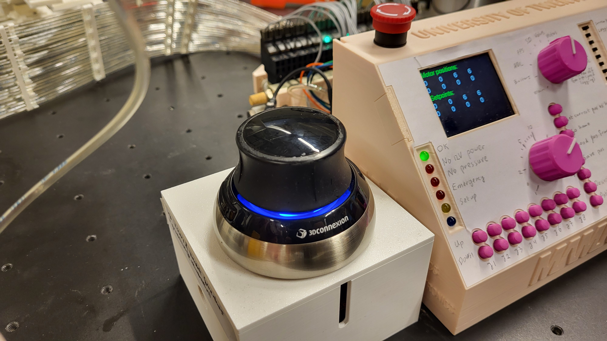
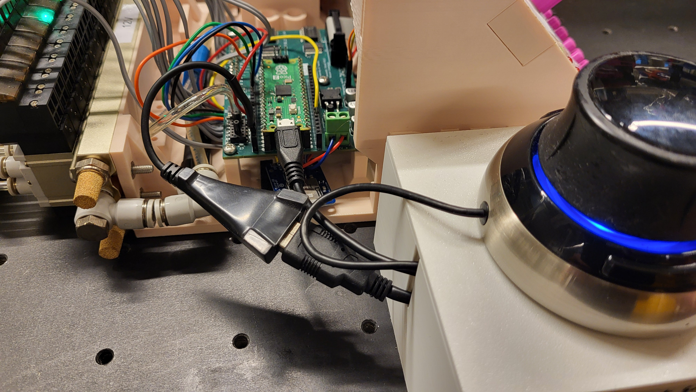
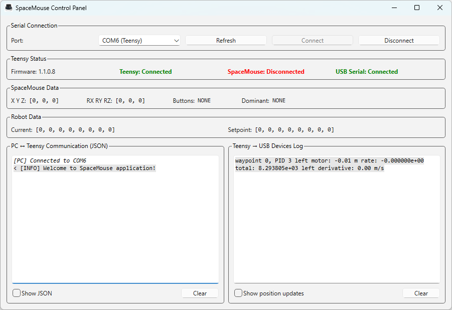

<!--- In Visual Studio Code, press Crtl-Shift-V to preview. -->

# SpaceMouse application for Teensy 4.1 version 1.0.0

(This is not the latest version, as there is 2.0.0 now)

To connect a SpaceMouse input device to a Mamri controller (v3 with Arduino Due, or v5 with Pico 2), an intermediate controller is required as neither the Due nor Pico offer USB host capabilities. A Teensy 4.1 can act as USB host and therefore read out the SpaceMouse state, which is processed and sent to the Mamri through an USB-serial interface.

This project offers a script for Teensy 4.1 to communicate with SpaceMouse and USB serial devices, with support for USB hubs. A GUI for the host PC is also available to examine status, adjust settings, etc.

*Figure 1. SpaceMouse on enclosed box housing Teensy 4.1 and USB hub.*

## Manual (Mamri integration)

*Figure 2. Connecting the SpaceMouse box to the Mamri controller.*

1. Connect SpaceMouse box to Mamri. See Figure 2. The male USB A plug from SpaceMouse box needs a 5V power source which is provided by Mamri's female USB A plug. The micro-USB cable goes in the Mamri controller (Pico 2(W) or Arduino Due).
2. Power on the Mamri. Wait one second till the blue ring of the SpaceMouse glows up.
3. Move the SpaceMouse. For Sunram 7 the following gestures are available:
    - Push left and right: joint 0
    - Rotate around Z axis: joint 1
    - Pull up / push down along Z axis: joint 2 and 3 in same direction
    - Tilt forward/back (rotation around X axis): joints 2 and 3 in opposite directions
    - Push button and then push (or tilt) forward/back: joint 4 to insert/retract needle

## GUI

*Figure 3. Screenshot of GUI*

When connecting the Teensy to a PC host, the GUI in Figure 3 can be used. Run the Python script in scripts/gui.py. It should auto-detect the COM port with the Teensy connected, show the connectivity status of the Teensy, SpaceMouse and USB Serial, and display PC<->Teensy message log and Teensy<->USB Serial message log.

## Onboard LED

The Teensy 4.1 has an onboard LED which always blinks during normal operation. The blinking pattern corresponds to the following states:

- 1 Hz, 5%: nothing connected
- 1 Hz, 25%: only usbserial connected
- 1 Hz, 50%: only SpaceMouse connected
- 2 Hz, 90%: both SpaceMouse and usbserial connected

If the onboard LED is permanently on (or off), the Teensy has crashed and should reboot within a few seconds.

## Troubleshooting

### Sunram 7 does not move
Check if pressure is available.
Ask Vincent for help.

### Teensy LED does not blink
Program has crashed. This may happen when plugging/unplugging serial. Reboot the controller redo the steps in manual, ask Vincent, etc.

### Message "JoystickController claim collection" in serial
Find the line with this message in `.platformio\packages\framework-arduinoteensy\libraries\USBHost_t36\joystick.cpp` and comment it out.

### Python: package serial not found
In a terminal or PowerShell, run the following command:
- pip install pyserial pyqt6

## Teensy crashes when Pico is plugged in USB hub
This was a known issue and should have been fixed now. Make sure to use the latest version of USBHost_t36 (from github). See [this forum post](https://forum.pjrc.com/index.php?threads/connecting-pico-to-teensy-4-1-usb-host-through-usb-hub-crashes-except-for-one-specific-hub-and-certain-ports.77469) for more details.

