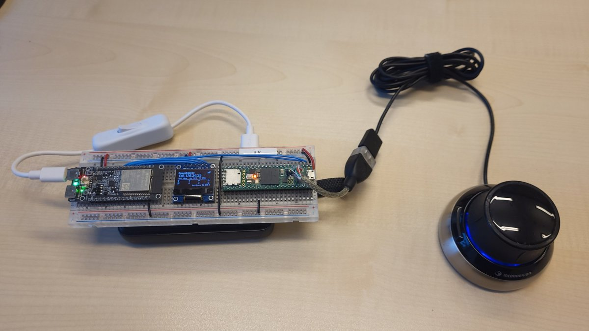

# SpaceMouse

Makes a 3Dconnexion SpaceMouse (a 6-DoF joystick) usable by microcontrollers and over Wi-Fi. A Teensy 4.1 acts as USB host for
the SpaceMouse and reads its six axes and buttons.

* [ESP32_and_Teensy_v2](ESP32_and_Teensy_v2): the current version. The Teensy passes the SpaceMouse's state over a serial line
  to an ESP32-C5, which shows it on an OLED and serves it on Wi-Fi (a live dashboard, a 3D view, a WebSocket stream).
  The ESP32-C5 firmware exists in two versions: [esp32-c5-idf](ESP32_and_Teensy_v2/esp32-c5-idf) (ESP-IDF, current: reports
  to the [CloSer lab demos page](https://closer.ram.eemcs.utwente.nl/labdemos/demo?id=spacemouse), updates over the air) and
  [esp32-c5](ESP32_and_Teensy_v2/esp32-c5) (Arduino, the original).
* [Teensy_v1](Teensy_v1): the first version: the Teensy alone, translating the SpaceMouse into messages for a Mamri robot
  controller over USB serial, typically to control a Sunram7 biopsy robot.

## History

Thijs Vissers made the initial application in 2024 for his BSc AT (Advanced Technology) graduation project: the first
Teensy 4.1 program for the SpaceMouse. In 2025 the software and hardware were redesigned (Teensy_v1), and in 2026 the Wi-Fi
version with the ESP32-C5 was added (ESP32_and_Teensy_v2). Thanks to Thijs for starting this project.

## Licence

MIT, see [LICENSE](LICENSE).
